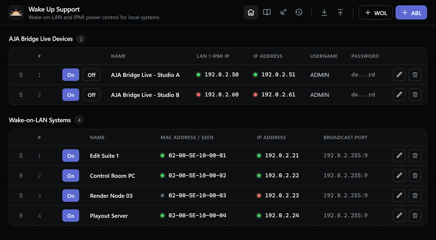
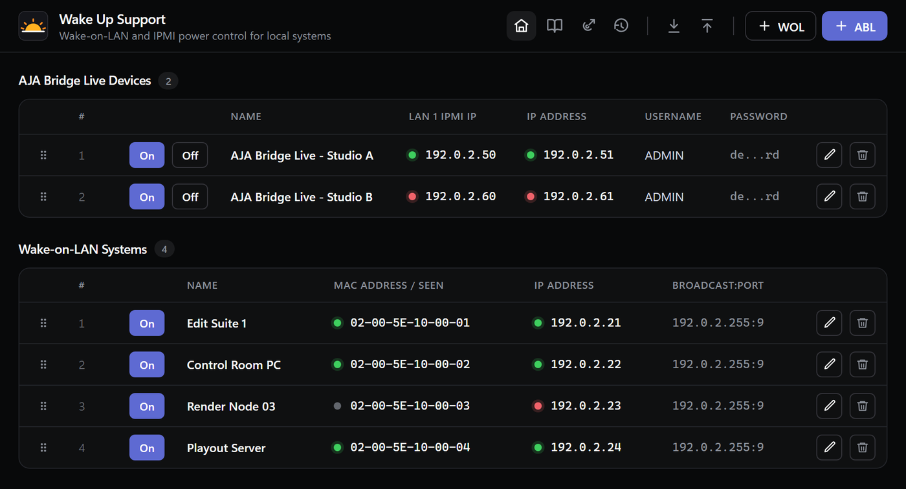
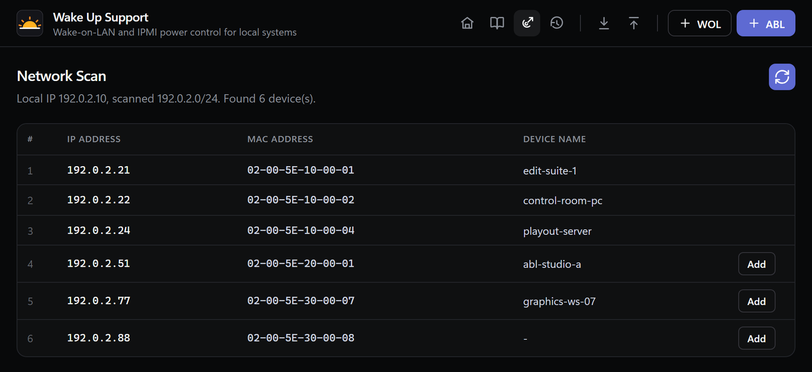

# Wake Up Support

_Wake-on-LAN and IPMI power control for local systems._

[](https://github.com/live-miracles/wake-up-support/releases/latest)
[](https://github.com/live-miracles/wake-up-support/actions/workflows/ci.yml)
[](https://github.com/live-miracles/wake-up-support/releases)
[](LICENSE)

[](https://live-miracles.github.io/projects/wake-up-support/)

**A small Windows desktop app that powers on the machines on your network with one click.** It sends Wake-on-LAN magic packets to ordinary PCs and uses IPMI to switch AJA Bridge Live devices on and off.

| [Download](https://github.com/live-miracles/wake-up-support/releases/latest) | [Getting started](docs/1-getting-started/1-introduction.md) | [Setup guides](docs/README.md) |
| ---------------------------------------------------------------------------- | ----------------------------------------------------------- | ------------------------------ |



## What it does

Wake Up Support keeps a list of the computers and devices you need to switch on, shows
whether each one is up, and powers them on with a single click. It suits any local network
where several machines have to be started remotely, from a home lab to a studio.

- **Wake-on-LAN** sends magic packets to ordinary PCs and servers, using the subnet's directed
  broadcast address and any UDP port (9 by default).
- **IPMI power control** turns AJA Bridge Live devices on **and off**. These do not support
  Wake-on-LAN, so the app talks IPMI through a bundled `ipmitool.exe`. Nothing extra to install.
- **Live status dots** show whether each system is reachable (green), not reachable (red) or
  unknown (grey), refreshed every 10 seconds.
- **Mapping warnings** flag an IP address and MAC address that do not match what the network
  reports.
- **Network scan** lists the devices on your local subnet and adds them as systems in one click.
- **Wake log** records recent wake and power actions made from the computer.
- **Import and export** the list of systems as JSON to move it to another PC.
- **Reorder** rows by dragging, and **zoom** the UI in or out.
- **Auto-update** notifies you when a new release is available.

## Screenshots

<table>
  <tr>
    <td width="50%"></td>
    <td width="50%"></td>
  </tr>
  <tr>
    <td align="center"><sub>Every system on one screen, with live status</sub></td>
    <td align="center"><sub>Scan the subnet and add devices</sub></td>
  </tr>
</table>

The screenshots use made-up devices on documentation-only IP addresses.

## Install

1. Download the Windows installer from the [latest release](https://github.com/live-miracles/wake-up-support/releases/latest).
2. Run it and launch **Wake Up Support**.
3. Enable the target hardware, then add it in the app:
   - Wake-on-LAN PCs: [Dell systems: Wake-on-LAN](docs/2-setup/1-dell-wake-on-lan.md)
     (the BIOS/UEFI and Windows steps apply to most vendors)
   - AJA Bridge Live: [IPMI power control](docs/2-setup/2-aja-bridge-live-ipmi.md)
4. Click **WOL** or **ABL** to add a system, then **On** to power it up.

The full walkthrough is in the [introduction](docs/1-getting-started/1-introduction.md). The
guides are also published on the
[Live Miracles site](https://live-miracles.github.io/projects/wake-up-support/docs/).

## Documentation

| Guide                                                          | Covers                                                      |
| -------------------------------------------------------------- | ----------------------------------------------------------- |
| [Introduction](docs/1-getting-started/1-introduction.md)       | What the app does and adding your first system              |
| [Dell Wake-on-LAN](docs/2-setup/1-dell-wake-on-lan.md)         | Enabling Wake-on-LAN in BIOS/UEFI and Windows               |
| [AJA Bridge Live IPMI](docs/2-setup/2-aja-bridge-live-ipmi.md) | Preparing the IPMI user, address and cipher suites over SSH |

## Development

Requires [Node.js](https://nodejs.org/) 22 or newer on Windows.

```powershell
npm install
npm run dev
```

### Build

```powershell
npm run build
npm run dist
```

`npm run dist` also checks that the bundled `ipmitool` files in [tools/](tools/README.md) are
present before it builds the installer.

### Format and test

```powershell
npm run format
npm run format:check
npm test
```

GitHub Actions runs the format check and build on every push and pull request.

### Publish

Publishing uses Electron Builder's GitHub publisher configuration from `package.json`.
Releases are published automatically when a version tag is pushed to GitHub.

```powershell
npm version x.x.x
git push origin master --tags
```

The tag push starts the release workflow, builds the Windows installer, and publishes a
GitHub release for that tag.

## Contributing

Issues and pull requests are welcome. Please run `npm run format` and `npm test` before
opening a pull request.

## License

[MIT](LICENSE)
